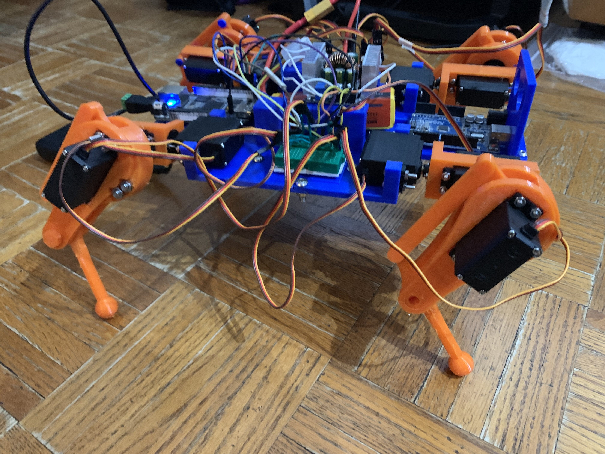
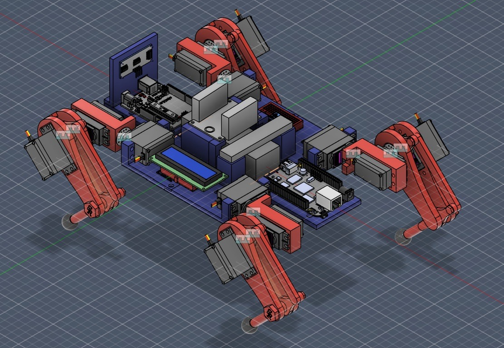

# Beagle Bot: A Simple Quadruped Robot (WIP)

Beagle Bot is a quadruped robot I worked on during the summer of 2025 (which I plan on taking further!). It features 12 MG996R servo motors which drive its legs, a 3S LiPo battery and DC-DC converter for board and motor power, with a BeagleBone Black Rev. C for control and communication. 

# Features
- On-board programmable real-time units (PRUs) eliminate the need for external motor controllers by driving PWM separately from the Linux side
- A simple inverse kinematics (IK) solver was implemented for easier control of the robot's walking gait
- A custom frame was designed using Fusion 360, and was printed using PETG
- Can be controlled remotely using an XBox or PS4 controller connected via Bluetooth

# Demo

# How does the code work?

The code is split into two main sections: 
- Code that runs on the Linux side, which does more complex math, makes the robot walk, and lets it communicate with other devices
- Real-time code on separate processing cores, directly controlling the motors to eliminate servo jitter

### Real-Time Code (on PRU)

#### servo_helper.asm

This file defines a function in Assembly which creates thirteen different software delay loops (one for each motor's position, and one to keep the PWM frequency at 50Hz). These delay values can be changed once set.

#### main.c

This file sets the PRU's memory to initial values, and then continuously reads it for changes from the Linux-side before updating the motors. This is how PWM control is implemented.

### Linux-Side Code

#### motor_utils.h and motor_utils.cpp
These files provide utilities for directly manipulating the PRU's memory on the Debian side of the BeagleBone Black, allowing the length of the duty cycle (and therefore the angle) sent to each motor to be changed based on controller input.

#### leg.h and leg.cpp
These files define a leg object, which sets up the coordinate system of each leg and its end effector/foot. Additionally, the set_ee function allows us to make IK calculations for where the foot should be based on a given local Cartesian coordinate position. 

#### beagle_robot.h and beagle_robot.cpp
Now that we have a leg defined, we can put four together to make a quadruped! These files set offsets for each leg on the robot, and define the walking gait for the quadruped collectively. It also allows for switching between standing and walking motions.

#### main.cpp
Here, everything above is put together, and joystick inputs are mapped to their corresponding outputs on the robot. A Robot object is instantiated, PRU memory is opened, and a robot object is created as well.

# Next Steps

In the future, I hope to add an IMU to help the robot balance in more difficult terrain, a distance sensor for collision avoidance, and a small LCD for monitoring battery levels and software errors while in operation.

### Mechanical
1. **Add rubber grips to feet**

    As evident in the demo, the feet of the robot don't have sufficient grip to make proper strides forward. This also affects lateral movement. 

### Electrical
1. **Add 5V buck converter to power board**

    The motors use 6V provided by the bulky DC-DC converter atop the robot. The board uses a different power level which should be handled by another converter (but at the moment is simply a power bank).

2. **Create a PCB for servo wiring and other components**

    The large amount of wires atop the robot creates makes it hard to diagnose electrical bugs, when they arise. It additionally makes it more dificult to add more components.

### Software

1. **Add a USB webcam and implement some form of image recognition**

    Although this is something I am still gaining experience in, I wish to add this to the robot to make it more versatile, though it may require a more powerful onboard computer. 

# Resources

The BeagleBoard PRU Cookbook by Mark A. Yoder is an extremely useful resource I used for learning how the PRU functions, as well as how to manage memory on it. Check it out [here](https://docs.beagleboard.org/books/pru-cookbook/index.html).